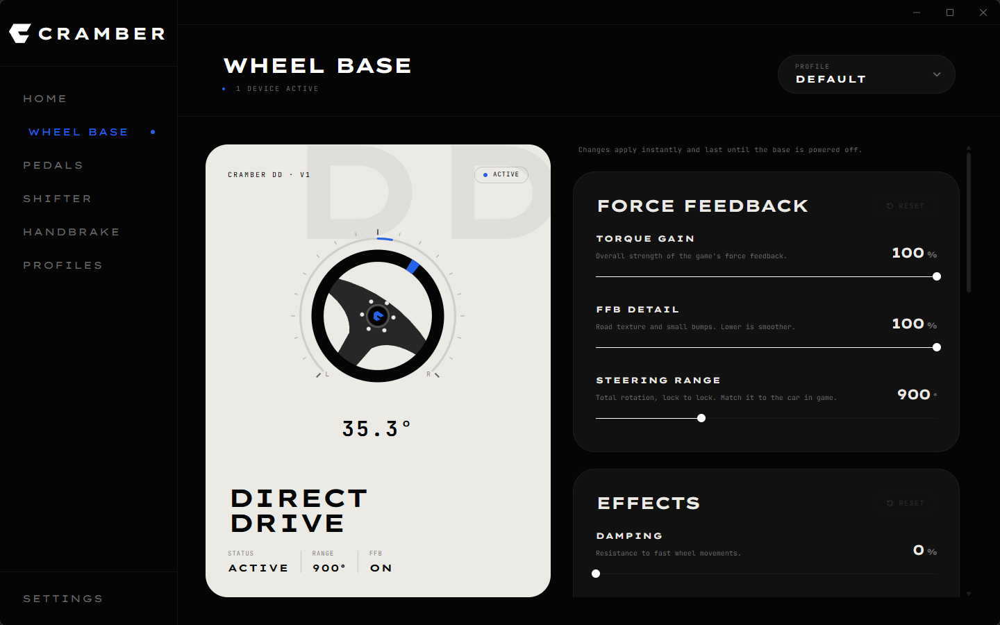

<div align="center">


# Cramber Hub

**Desktop app for Cramber sim racing hardware**

Force feedback tuning · Profiles · Automatic switching by game

[](LICENSE)
[](#getting-started)
[](https://tauri.app/)
[](https://svelte.dev/)

[Getting started](#getting-started) · [Wheel base firmware](https://github.com/cramber-racing/cramber-basewheel) · [Factory tool](https://github.com/cramber-racing/cramber-basewheel-factory)

</div>

<br>

<p align="center">
    
</p>

<br>

Cramber Hub is where you set up your Cramber hardware. Adjust the wheel base's force feedback while you
drive, save your settings in profiles and let the app switch to the right profile as soon as a game starts.
It runs quietly in the system tray, so your settings are on the base before you open a game.

> [!NOTE]
> This project is in active development. Firmware and apps are updated together, so keep them on matching
> versions.

## Ecosystem

| Project | Description |
| --- | --- |
| **[cramber-basewheel](https://github.com/cramber-racing/cramber-basewheel)** | Firmware that runs on the wheel base |
| **[cramber-hub](https://github.com/cramber-racing/cramber-hub)** | Desktop app to adjust force feedback and manage profiles *(this repository)* |
| **[cramber-basewheel-factory](https://github.com/cramber-racing/cramber-basewheel-factory)** | Calibration and diagnostics tool used when building a base |

## Features

<table>
<tr>
<td valign="top" width="50%">

**Wheel base**
- Torque gain, FFB detail and steering range up to 2700°
- Damping, friction and inertia
- Idle spring that centers the wheel while no game is running
- Virtual end stops with adjustable hardness, cushion and width
- Changes apply instantly, with a reset to factory defaults
- Live view of the wheel position

**Profiles**
- Every change is saved into the active profile
- The active profile is sent to the base whenever it connects
- Import and export profiles as files

</td>
<td valign="top" width="50%">

**Automatic switching by game**
- Link a game to a profile
- The profile switches when the game starts and back when it closes
- 17 popular sim racing games recognized, or pick any `.exe`

**App**
- Runs in the system tray, with quick profile switching
- Optional start with Windows
- Light, dark and system theme
- Windows 11 snap layouts

</td>
</tr>
</table>

## Supported devices

| Device | Status |
| --- | --- |
| **Cramber DD** wheel base | ✅ Supported |
| **Cramber Pedals** | 🚧 Preview, hardware in development |
| **Cramber Shifter** | 🚧 Preview, hardware in development |
| **Cramber Handbrake** | 🚧 Preview, hardware in development |

<details>
<summary>Games recognized for automatic switching</summary>

<br>

| | |
| --- | --- |
| Assetto Corsa | Assetto Corsa Competizione |
| Assetto Corsa EVO | iRacing |
| Le Mans Ultimate | rFactor 2 |
| Automobilista 2 | RaceRoom |
| BeamNG.drive | F1 24 · F1 25 |
| EA SPORTS WRC | DiRT Rally 2.0 |
| Richard Burns Rally | Forza Horizon 5 |
| Euro Truck Simulator 2 | American Truck Simulator |

</details>

## Getting started

### 1. Install the tools

- [Bun](https://bun.sh/)
- [Rust](https://www.rust-lang.org/tools/install)
- The [Tauri prerequisites for Windows](https://tauri.app/start/prerequisites/) (Microsoft C++ Build Tools and WebView2)

### 2. Run

Clone the repository and install the dependencies:

```sh
bun install
```

Start the app in development mode. The window reloads as you edit the code:

```sh
bun tauri dev
```

### 3. Connect the base

Plug in a Cramber DD running the `release` firmware build. The app finds it automatically, shows it on the
dashboard and unlocks the Wheel Base page.

### 4. Build the installer

```sh
bun tauri build
```

The installer is written to `src-tauri/target/release/bundle`.

## License

Licensed under the [GPL-3.0](LICENSE). Third party libraries keep their own licenses.
